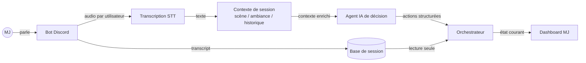

# Vue d'ensemble fonctionnelle

**Statut** : ✅ Implémenté (Phase 1, en partie)
**Partie(s) concernée(s)** : l'ensemble du projet

## Objectif

RPG-Assistant augmente une session de jeu de rôle sur table (JdR) jouée via Discord : il écoute la narration du Maître du Jeu, en tire un contexte de scène/ambiance, et déclenche automatiquement des actions d'ambiance (musique, image, conseils) pendant que la partie se joue — sans que le MJ ait besoin de piloter manuellement un deuxième outil.

## Acteurs

| Acteur | Rôle |
|---|---|
| **MJ (Maître du Jeu)** | Narre la partie, donne son consentement à l'enregistrement, pilote les commandes `/session`, consulte le dashboard |
| **Joueur** | Participe vocalement à la session ; son audio est capté séparément mais n'est pas la priorité d'analyse |
| **Bot Discord** | Capture l'audio par utilisateur, gère le cycle de vie de session, affiche le statut de consentement |
| **Agent IA** | Transforme transcript + contexte en décisions structurées (musique/image/conseil/règles) |
| **Orchestrateur** | Reçoit les décisions de l'agent, maintient un état courant, l'expose au dashboard |
| **Dashboard MJ** | Affiche en continu l'état courant pour le poste du MJ (deuxième écran, stream OBS…) |

## Parcours fonctionnel cible (vision complète, Phase 1+2 combinées)

1. Le MJ lance `/session start` dans son salon vocal → le bot affiche une notice de consentement, rejoint le vocal, commence à capter l'audio par participant.
2. La parole du MJ (et des joueurs) est transcrite en texte, en continu ou par petits segments.
3. Le contexte de session (scène, ambiance, historique récent, musique/image actives) est maintenu à jour à chaque nouvelle réplique.
4. Périodiquement (ambiant) ou sur déclencheur (mot-clé, commande manuelle), ce contexte est envoyé à l'agent IA, qui répond avec une ou plusieurs actions structurées.
5. Ces actions sont dispatchées par l'orchestrateur : changement de musique, affichage d'une image, conseil au MJ, aide de règles.
6. Le dashboard MJ reflète ces changements en quasi-temps réel.
7. En fin de séance, `/session stop` arrête tout, et `/session transcribe` produit une transcription complète exploitable (texte + base de données) pour la suite (résumés, prochaine séance).

> ⚠️ À date (voir [06 — Câblage bout-en-bout](06-cablage-bout-en-bout.md)), les étapes 1, 2, 6 et 7 fonctionnent réellement ; les étapes 3 à 5 existent comme briques indépendantes et testées, mais ne sont pas encore reliées automatiquement pendant une session réelle.

## Architecture fonctionnelle

## Glossaire métier

| Terme | Définition |
|---|---|
| MJ / GM | Maître du Jeu — narrateur/arbitre de la partie |
| Joueur | Participant jouant un personnage |
| Scène | Le moment narratif courant (exploration, combat, social…) |
| Ambiance / Mood | La tonalité émotionnelle de la scène (mystérieux, tendu, joyeux…) |
| Session | Une séance de jeu (généralement 2 à 5 heures) |
| Campagne | Une suite de séances liées |
| Asset | Un morceau de musique ou une image de la bibliothèque locale |
| Action | Une décision structurée produite par l'agent IA (musique, image, conseil, règle) |
| Déclencheur (trigger) | Ce qui provoque un appel à l'agent IA : polling ambiant, mot-clé détecté, commande manuelle |

## Phases du projet (résumé fonctionnel)

| Phase | Ce que ça apporte fonctionnellement | Statut |
|---|---|---|
| Phase 1 — MVP | Capture + transcription + briques IA/orchestrateur/dashboard indépendantes, utilisables manuellement | 🧩 Quasi complet (reste le câblage automatique, spec 06) |
| Phase 2 — Robustesse | Déclenchement réellement automatique (mots-clés), commandes `/scene`/`/mood`, intégration OBS, résumés de séance | 📝 Non commencé |
| Phase 3 — Full local | STT et LLM exécutés localement (pas d'API externe), recherche sémantique d'assets | 📝 Non commencé |

## Specs détaillées

Voir l'[index](README.md) pour le détail par partie.
